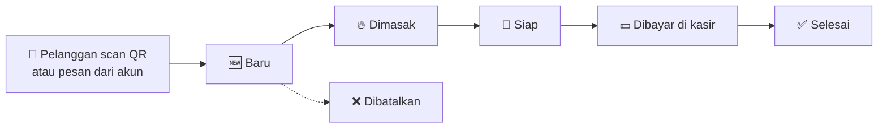
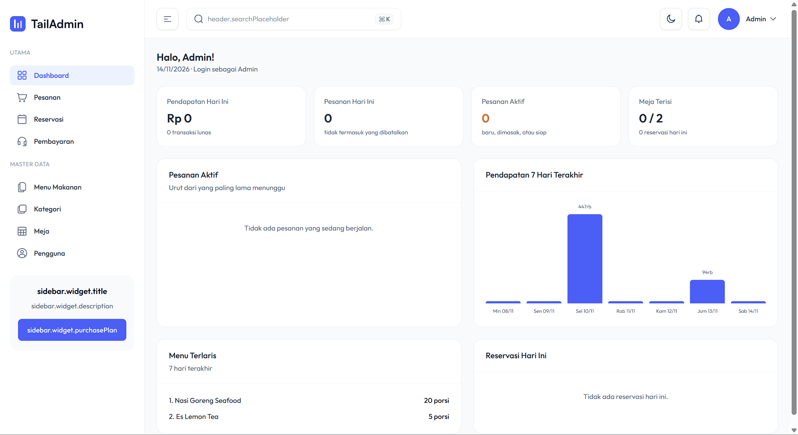
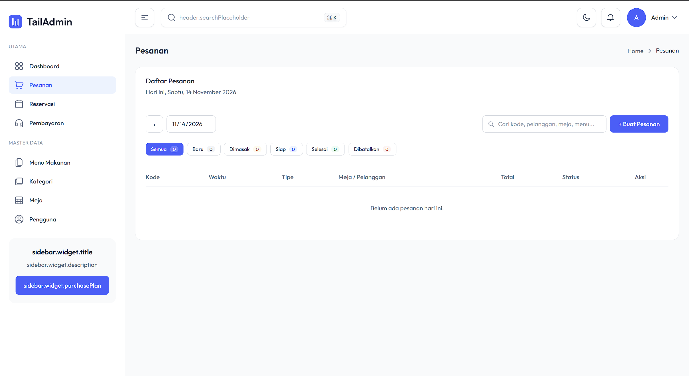
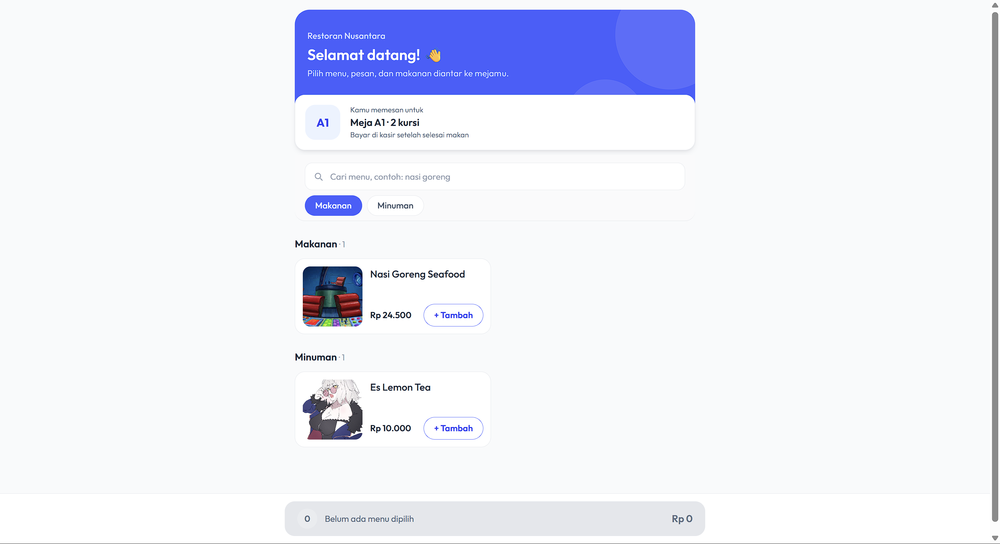
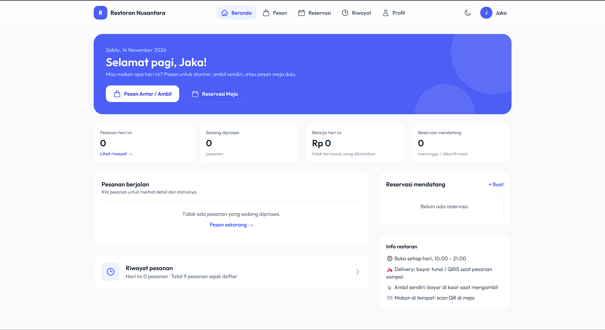

<div align="center">

# 🍛 Restoran Nusantara

### *Rasa Nusantara, pesan semudah scan.*

Sistem layanan kuliner dan restoran berbasis web: pesan dari meja lewat QR, pesan antar/ambil dari rumah, reservasi meja, sampai dapur dan kasir yang bekerja di satu layar.


Proyek Akhir **Praktikum Pemrograman Web** · Kelompok **2**

</div>

---

## 📖 Tentang

**Restoran Nusantara** menghubungkan pelanggan, kasir, dan dapur dalam satu aplikasi:

- 📱 **Pelanggan di restoran** cukup scan QR di meja, pilih menu, dan pesanan langsung masuk ke dapur, tanpa login.
- 🏠 **Pelanggan di rumah** bisa pesan antar/ambil dan reservasi meja dari akunnya.
- 🧑‍🍳 **Koki** melihat antrean masakan dan mengubah statusnya.
- 💵 **Kasir** mencatat pesanan dan pembayaran, kembalian dihitung otomatis.
- 🛠️ **Admin** mengelola menu, meja, pengguna, dan memantau penjualan.

---

## ✨ Fitur

### 🔐 Akun dan keamanan
- Login, daftar akun pelanggan, logout
- Hak akses per role: **admin, kasir, koki, pelanggan**
- Lupa password lewat email (khusus pelanggan)
- Pelanggan bisa mengubah profil, ganti password, dan menonaktifkan akunnya sendiri

### 🍽️ Pemesanan
- **Pesan lewat QR meja**: katalog menu per kategori, pencarian, keranjang, catatan per menu, dan halaman status pesanan
- **Pesan antar / ambil sendiri** untuk pelanggan yang login
- Alur status pesanan: `baru → dimasak → siap → selesai`
- Pembayaran tunai / QRIS / transfer dengan **kembalian otomatis**

### 📅 Reservasi
- Pelanggan mengajukan reservasi, kasir/admin memilihkan meja dan mengonfirmasi

### 📊 Operasional restoran
- **Dashboard**: pendapatan hari ini, grafik 7 hari, menu terlaris
- **Pesanan per hari**: daftar dan jumlah per status mulai dari 0 setiap hari, hari sebelumnya tetap bisa dibuka lewat kalender
- **Notifikasi** di lonceng: pesanan baru, pesanan siap, reservasi menunggu
- **Pencarian dan filter** di Pesanan, Menu, Pengguna, dan Reservasi
- **Cetak kartu QR** untuk setiap meja
- Upload foto menu
- Paginasi 15 / 50 / 100 data
- Mode terang dan gelap

### 👥 Siapa bisa apa

| Fitur | Admin | Kasir | Koki | Pelanggan | Tamu (QR) |
|---|:-:|:-:|:-:|:-:|:-:|
| Dashboard | ✅ | ✅ | ✅ | | |
| Kelola kategori, menu, meja | ✅ | | | | |
| Kelola pengguna | ✅ | | | | |
| Catat pesanan & pembayaran | ✅ | ✅ | | | |
| Ubah status masakan | ✅ | ✅ | ✅ | | |
| Kelola reservasi | ✅ | ✅ | | | |
| Pesan antar / ambil, reservasi | | | | ✅ | |
| Pesan dari meja lewat QR | | | | | ✅ |

---

## 🔄 Alur pesanan



---

## 🖼️ Tampilan

| Dashboard | Pesanan per hari |
|---|---|
|  |  |

| Pesan lewat QR (HP) | Beranda pelanggan |
|---|---|
|  |  |

---

## 🛠️ Teknologi

| Bagian | Yang dipakai |
|---|---|
| Backend | Laravel 12, PHP 8.2+ |
| Database | MySQL |
| Tampilan | Blade, Tailwind CSS 4, Alpine.js, Vite |
| Template admin | [TailAdmin Laravel](https://github.com/TailAdmin/tailadmin-laravel) (lisensi MIT) |
| QR code | bacon/bacon-qr-code |

---

## 🚀 Cara menjalankan

### Yang perlu terpasang
Laragon (atau XAMPP), PHP 8.2+, Composer, Node.js, dan Git.

### Langkah instalasi (Laragon)

1. **Clone** repo ke `C:\laragon\www\restoran`
   ```bash
   git clone [link repo] restoran
   cd restoran
   ```
2. **Install library**
   ```bash
   composer install
   npm install
   ```
3. **Buat file `.env`**
   ```bash
   copy .env.example .env
   php artisan key:generate
   ```
4. **Import database**: buat database `restoran`, lalu di HeidiSQL pilih **File > Run SQL file...** dan pilih `database/sql/restoran.sql`.
   > ⚠️ Jangan jalankan `php artisan migrate`. Struktur tabel sudah ada di file SQL.
5. **Hubungkan folder foto menu**
   ```bash
   php artisan storage:link
   ```
6. **Jalankan**
   ```bash
   npm run dev
   ```
   Buka **http://restoran.test**

> 💡 Memakai XAMPP? Jalankan `php artisan serve`, lalu buka http://127.0.0.1:8000 dan ubah `APP_URL` di `.env` ke alamat itu.

### 📧 Email lupa password (opsional)
Bawaannya `MAIL_MAILER=log`: email reset password ditulis ke `storage/logs/laravel.log`. Untuk melihat email sungguhan saat demo, isi pengaturan SMTP dari [Mailtrap](https://mailtrap.io) (Sandbox) di `.env` milikmu sendiri.

---

## 🔑 Akun demo

| Role | Email | Password |
|---|---|---|
| 🛠️ Admin | admin@restoran.test | admin123 |
| 💵 Kasir | kasir@restoran.test | kasir123 |
| 🧑‍🍳 Koki | koki@restoran.test | koki123 |
| 🙋 Pelanggan | [email pelanggan demo] | [password] |

Tamu tanpa akun: buka menu **Meja**, cetak QR salah satu meja, lalu scan atau buka link-nya.

---

## 🗂️ Struktur penting

```
app/Http/Controllers/   → logika setiap halaman
app/Http/Middleware/    → CekRole (hak akses per role)
resources/views/pages/  → tampilan setiap halaman
routes/web.php          → daftar alamat halaman
database/sql/           → file database untuk di-import
```

---

## 👨‍👩‍👧‍👦 Tim

| Nama | NIM | Peran |
|---|---|---|
| [Sattari Radjasyah Hidayat] | [123250190] | [Backend, database, Desain Tampilan] |
| [Indra Okta Nugraha] | [123250188] | [Desain Tampilan, Laporan Proyek] |

---

<div align="center">

Dibuat dengan 🍛 dan semangat Nusantara.

Template admin oleh [TailAdmin](https://tailadmin.com) · lisensi MIT

</div>
